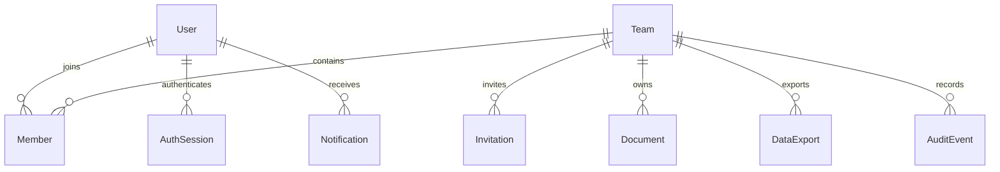

# 统一架构约定

状态：当前五步实现的架构边界；扩展部分明确标记。范围与顺序见 [实施计划](../doc/saas-implementation-plan.md)。

## 核心模型与边界

- User 是全局身份；Team 是租户和资源边界；Member 是用户在团队内的角色。使用 `team_id`，不引入计费模型。
- 团队创建和首位 owner 同事务。非删除状态的团队必须保留有效 owner；删除完成保留匿名 Team 墓碑，成员清空。
- 固定 owner/admin/member/viewer；角色不存入长期 JWT。JWT 固定 90 天，授权每次根据当前身份、成员和资源检查。
- AdminUser 是独立平台身份，角色为 support/super_admin，不与团队 owner 混用。
- 团队业务记录包含非空 team_id、外键和索引；Notification、AuditEvent、邮件等明确支持个人/平台事件的表允许空 team_id，并使用独立访问规则。
- User/AdminUser 主键为 integer，新增引用必须匹配；新团队等业务表使用 bigint。

## 请求与授权链路

Bearer 认证 → 从有效成员关系解析可见 Team → 从该团队 scope 查询资源 → 普通 Ruby Policy 校验动作 → 服务复核当前状态并加锁 → 写业务、审计及投递意图。

- **不使用 Pundit 或其他权限库。** `Authorization` 登记支持的资源和策略，未知动作/资源默认拒绝。
- 未认证返回 401；可见团队内动作无权返回 403；不可见团队或跨团队资源返回 404。成员移除后已有 JWT 立即失去团队访问权。
- `Current.user/team/request_id/job_id` 仅作上下文与日志关联，不能代替查询 scope 或服务授权。请求和任务完成后清理；Job 从数据库记录重建上下文。
- 暂停团队拒绝业务写入，允许已有成员读取；owner/admin 可申请自己的导出。删除冷静期冻结写入，取消走独立删除请求接口。
- 涉及用户加入团队或成为 owner 的流程先取得按用户 ID 排序的事务 advisory lock，再取得团队行锁；账号删除使用相同顺序，避免最后 owner 与删除并发绕过。

## 代码落点

| 职责 | 当前位置 | 约束 |
| --- | --- | --- |
| 模型与数据库约束 | app/models、db/migrate | 校验之外有唯一索引、非空、外键和状态约束 |
| API | app/controllers/api/v1 | SaasController 统一响应；TeamContextController 解析团队 |
| 权限 | app/policies、app/services/authorization.rb | 普通 Ruby，动作白名单，默认拒绝 |
| 业务与并发 | app/services | 操作入口复核身份、归属、团队状态，集中事务和锁 |
| 上下文 | app/models/current.rb、ApplicationJob | 不能作为唯一安全边界；日志关联后清理 |
| JSON 展示 | app/views/api/v1、app/presenters | 明确字段，不序列化完整敏感模型 |
| 后台 | app/admin、lib/platform_authorization.rb | 独立 AdminUser 权限域，危险动作不开放通用 CRUD |
| 异步处理 | app/jobs | GoodJob；有限重试、租约/锁、失败恢复、执行时复核 |
| 验证 | spec/requests、spec/services、spec/jobs、spec/models | 包含跨团队、并发、重复执行和故障路径 |

## API 与兼容

- 保留 `/users/*` 和 `/api/v1/user`；团队接口前缀为 `/api/v1/teams/:team_id`。后文 `.../resource` 均指此前缀。
- 新接口成功 `{ data, meta }`，失败 `{ errors: [{ code, message, field }], request_id }`；存量认证和资料响应保持兼容。
- 创建 201，异步受理 202，成功无内容删除 204；参数错误 400、校验失败 422、状态冲突 409、限流 429 并提供 Retry-After。
- 列表默认 20 条，上限 100，按 ID 稳定排序。只允许明确字段；不是所有列表都支持搜索和任意排序。
- 时间持久化为 UTC，输出 ISO 8601。用户偏好覆盖团队默认，平台默认 en/UTC；支持语言 en、zh-CN。

## 事务、异步与外部副作用

- 成功业务写入、AuditEvent 和邮件/通知投递意图在同一事务；外部 SMTP/存储操作使用任务和恢复记录。
- 当前实现邮件专用 MailDelivery outbox 及 NotificationDelivery，不存在通用 OutboxEvent 或全局 Idempotency-Key 框架。
- 邀请/通知事件键与数据库约束防重复业务记录；任务通过租约或 advisory lock 防并行处理，执行前重查权限和状态。
- SMTP 只能承诺至少一次尝试；外部发送成功但确认状态失败时可能重复邮件，不能承诺恰好一次。
- 导出先持久化 staging blob 引用再上传，避免失败后遗留不可追踪文件；远端删除成功后再清理本地 blob 元数据。
- 删除先提交不可取消的 processing 决策，再持久化独立删除台账，台账成功后才进入破坏性清理。

## 删除、保留与恢复

- Team 状态 active/suspended/deletion_pending/deleting/deleted；账号删除冷静期保留登录以便取消，开始执行才封禁并撤销凭证。
- 默认冷静期 7 天，导出有效 24 小时，审计保留 365 天。具体边界见 [生命周期手册](../doc/saas-data-lifecycle.md)。
- 数据库备份恢复后必须在重新开放流量前重放独立删除台账。台账目录需独立于数据库备份保存，模板不自动创建生产备份。

## 扩展与上线

计费、商业权益/配额、API Key、对外 Webhook、SSO、MFA、通用导入均未实现，不在当前授权链中。未来如需接入，应独立设计状态、幂等和迁移，不能将扩展草案当作现有能力。

上线遵循扩展字段 → 核对/回填 → 切换 → 收紧约束；历史账号不自动确认邮箱。生产邮件、存储、告警、RPO/RTO 和灾备演练需部署方验证，见 [运行手册](../doc/saas-operations.md)。
